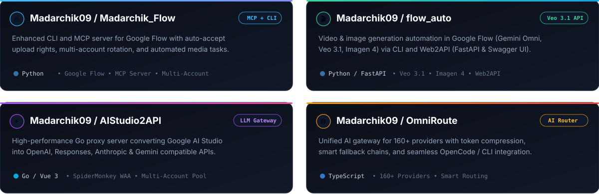
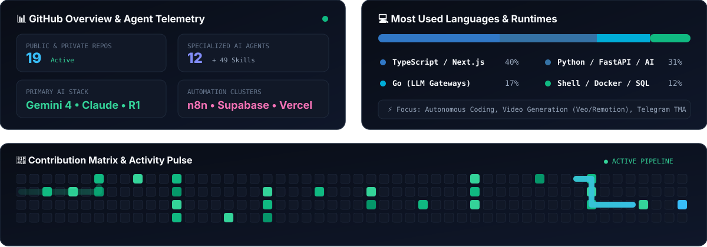

  

 

<!-- 1. BADGES & CORE FOCUS -->

  
  
  
  

 

<!-- 2. TECH STACK ICONS & BADGES -->
### 🛠️ Tech Stack & Infrastructure

  

 

  
  
  
  
  
  
  
  
  
  
  

---

<!-- 3. FEATURED PROJECTS BENTO SHOWCASE -->
### 🚀 Featured Projects & AI Gateways

  

 

  
  
  
  

---

<!-- 4. STATS, LANGUAGES & ANIMATED SNAKE -->
### 📈 GitHub Telemetry, Languages & Activity

  

---

  ⚡ Crafted by <b>Aiur Tsy (@Madarchik09)</b> • Powered by Multi-Agent OpenCode Architecture

